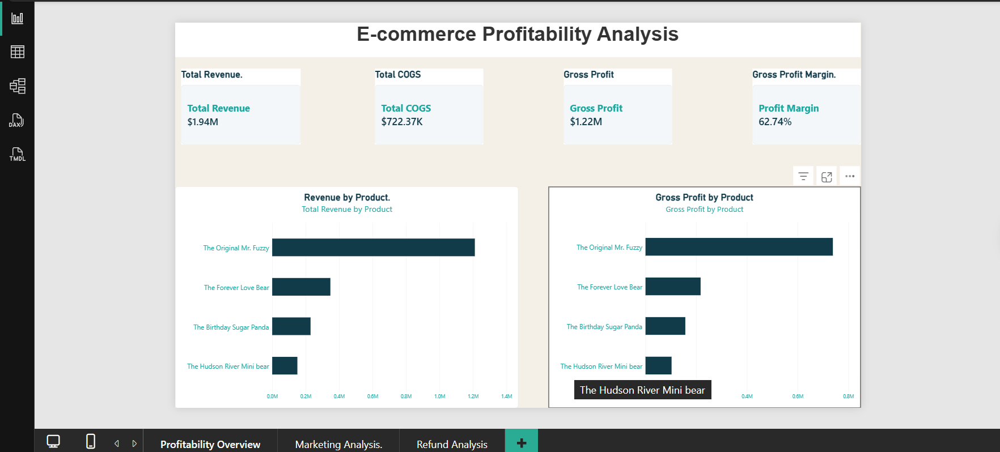
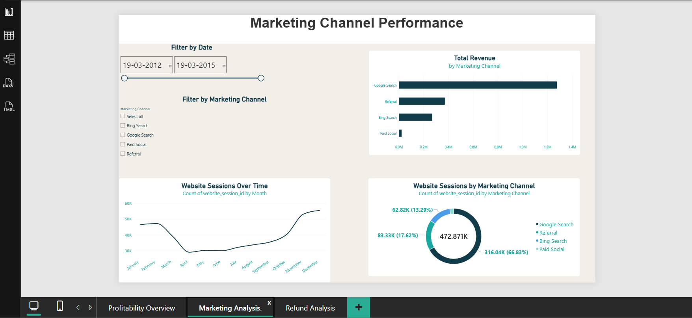
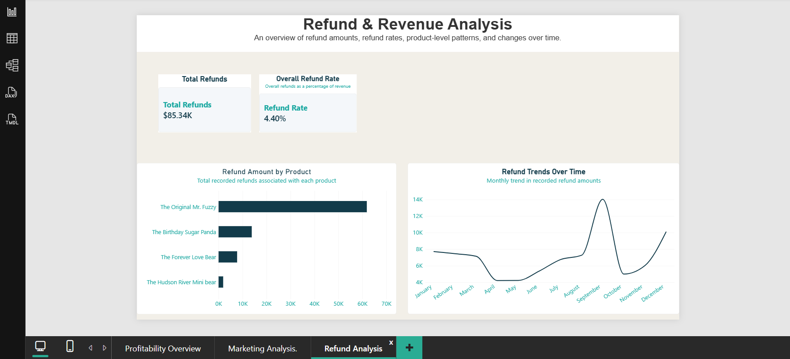

# E-commerce Profitability Analysis

## Project Overview

This project analyzes e-commerce sales, product profitability, marketing-channel performance, website traffic, and customer refunds using Microsoft Excel, Power Query, and Power BI.

The goal is to transform raw e-commerce data into an interactive dashboard that helps identify revenue trends, compare product performance, understand website traffic sources, and monitor refunds.

## Business Objectives

- Analyze total revenue, cost of goods sold (COGS), and gross profit.
- Compare revenue and gross profit across products.
- Explore website sessions and revenue by marketing channel.
- Track refund amounts by product and over time.
- Present findings through interactive Power BI dashboards.

## Tools and Technologies

- Microsoft Excel
- Power Query
- Microsoft Power BI
- DAX (Data Analysis Expressions)
- Git and GitHub

## Dataset

The project uses the Maven Fuzzy Factory e-commerce dataset from Maven Analytics.

The dataset includes order records, order items, products, refunds, website sessions, and website pageviews.

Source: [Maven Analytics Data Playground](https://mavenanalytics.io/data-playground/toy-store-e-commerce-database)

## Dashboard Pages

### 1. Profitability Overview
- Total Revenue
- Total COGS
- Gross Profit
- Gross Profit Margin
- Revenue by Product
- Gross Profit by Product

### 2. Marketing Channel Performance
- Revenue by Marketing Channel
- Website Sessions by Marketing Channel
- Website Sessions Over Time
- Interactive date and marketing-channel filters

### 3. Refund Analysis
- Total Refunds
- Overall Refund Rate
- Refund Amount by Product
- Refund Trends Over Time

## Dashboard Preview

### 1. Profitability Overview

### 2. Marketing Channel Performance

### 3. Refund Analysis

## Key Metrics

- **Total Revenue:** Sum of order-item selling prices.
- **Total COGS:** Sum of the cost of goods sold for order items.
- **Gross Profit:** Total Revenue minus Total COGS.
- **Gross Profit Margin:** Gross Profit divided by Total Revenue.
- **Total Refunds:** Sum of recorded refund amounts.
- **Overall Refund Rate:** Total Refunds divided by Total Revenue.

## Data Preparation and Methodology

Power Query was used to prepare the data for analysis. The data model connects orders, order items, products, refunds, website sessions, and pageviews using their relevant identifiers.

Product categories and marketing-channel groupings are analyst-created classifications based on the available fields. They are intended for exploratory analysis and may not represent official business categories or verified advertising attribution.

## Limitations

- Marketing expenditure is not included, so advertising ROI cannot be calculated.
- Gross profit does not include refunds, marketing expenses, shipping, or other operating costs.
- Product categories are analyst-defined rather than supplied as official dataset categories.
- Refunds and revenue may be recorded on different dates; monthly refund amounts should not be interpreted as monthly refund rates without matching date-filter logic.

## Project Status

The three-page Power BI dashboard has been built. Final validation, documentation, and portfolio presentation are in progress.

## Author

Anshika Sharma

